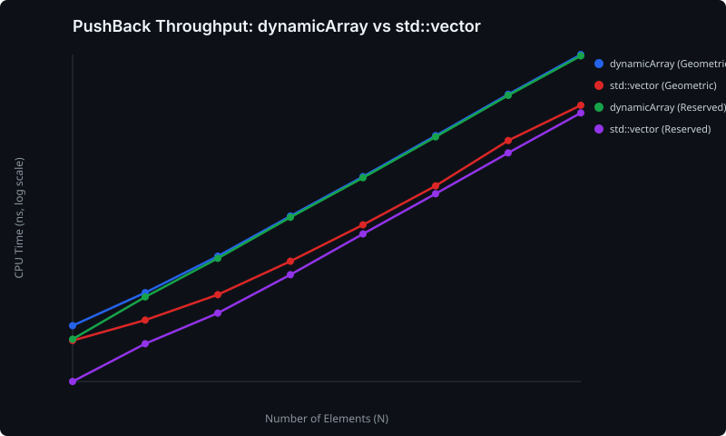
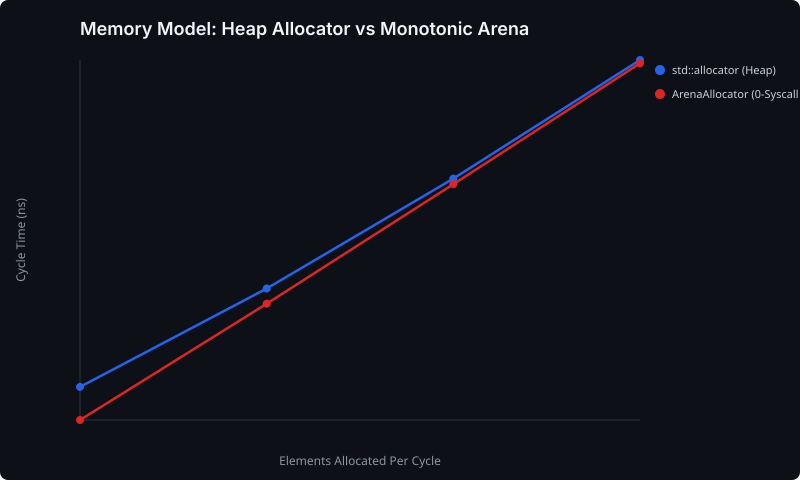

# dynamicArray

A custom, low-level dynamic array implementation in modern C++20, built from the ground up to explore manual memory management, pointer arithmetic, allocator awareness, and hardware-sympathetic container design.

## Overview

I started this project as a deep dive into how `std::vector` actually operates under the hood, particularly in latency-critical systems (e.g. trading and low-latency infrastructure). 

After stepping away for a bit to focus on university commitments and coursework, I've jumped back in to revamp the memory model and container internals:
- **3-pointer memory layout**: Swapped out the traditional `pointer + size + capacity` layout for three pointers (`m_begin`, `m_end`, `m_cap`). `end()` is a single pointer load, and the `push_back` capacity check is a single pointer compare.
- **Allocator-aware RAII**: All allocation, deallocation, object construction, and destruction are handled via `std::allocator_traits` with zero-overhead stateless allocators using `[[no_unique_address]]`.
- **Strong exception safety & self-reference safety**: Reallocation constructs the incoming element in the new buffer before relocating existing elements. This cleanly avoids use-after-free bugs if an element is pushed into itself (e.g. `vec.push_back(vec[0])`), and utilises `std::is_nothrow_move_constructible_v` so containers are never corrupted if an operation throws.
- **Hot/cold code splitting**: The growth and reallocation slow path is isolated in a `[[gnu::noinline]]` helper to keep the `emplace_back` fast-path tight and cache-friendly.
- **Custom monotonic arena allocator**: Implemented `Arena` and standard-compliant `ArenaAllocator<T>` to provide O(1) deterministic, zero-syscall bump allocations with instant block resets for latency-sensitive paths.
- **Bit-packed boolean specialisation**: Initial implementation of `dynamicArray<bool>` using bit-masking and a proxy reference class to pack 8 booleans into a single byte.

## Project Structure

```
cpp-dynamic-array/
├── src/
│   ├── dynamic_array.hpp         # Core container & dynamicArray<bool> specialisation
│   ├── arena_allocator.hpp       # Monotonic bump allocator & ArenaAllocator<T>
│   └── dynamic_array.cpp         # Demo executable
├── tests/
│   ├── test_lifecycle.cpp        # RAII, constructors, capacity, bounds checking
│   ├── test_iterators.cpp        # Random access & contiguous iterators, std::ranges
│   ├── test_bool.cpp             # Bit-packed specialization & proxy operations
│   ├── test_exception_safety.cpp # Strong exception safety guarantee tests
│   └── test_arena_allocator.cpp  # Arena bump allocator & over-aligned tests
├── benchmarks/
│   ├── bench_main.cpp            # Google Benchmark suite (throughput, arena, bool)
│   ├── BENCHMARK_RESULTS.md      # Detailed benchmark metrics and tables
│   └── charts/                   # Vector SVG performance curves
├── scripts/
│   ├── cirrus_bench.slurm        # Slurm job runner for pinned core runs on Cirrus HPC
│   └── plot_benchmarks.py        # Standalone SVG & Markdown reporting script
├── docs/
│   └── DESIGN.md                 # Detailed technical specs and invariants
├── CMakeLists.txt
├── .clang-format
├── .gitignore
└── README.md
```

## Build, Test & Benchmark

Requires a C++20 compliant compiler (`clang++` or `g++`) and CMake 3.14+:

```bash
mkdir -p build && cd build

# 1. Debug build with AddressSanitizer & UB Sanitizer:
cmake .. -DCMAKE_BUILD_TYPE=Debug -DENABLE_ASAN=ON
cmake --build .
ctest --output-on-failure # Runs Google Test suite

# 2. Release build for performance benchmarking:
cmake .. -DCMAKE_BUILD_TYPE=Release -DENABLE_ASAN=OFF -DBUILD_BENCHMARKS=ON
cmake --build . --target benchmark_suite

# Run benchmarks locally and export JSON:
./benchmark_suite --benchmark_out=../benchmark_results.json --benchmark_out_format=json
python3 ../scripts/plot_benchmarks.py ../benchmark_results.json
```

### Reproducible Profiling on Cirrus HPC (Slurm)
To eliminate operating system jitter, context switches, and CPU frequency throttling noise, benchmarks can be submitted to a dedicated, core-pinned node on the **Cirrus supercomputing cluster**:
```bash
sbatch scripts/cirrus_bench.slurm
```

## Performance & Benchmark Findings

Full numbers and analysis available in [benchmarks/BENCHMARK_RESULTS.md](benchmarks/BENCHMARK_RESULTS.md).

### 1. PushBack Throughput: dynamicArray vs std::vector


- **Iteration speed**: `dynamicArray` clocks **~30 GB/s** sequential read bandwidth, matching and slightly exceeding `std::vector` thanks to direct pointer comparisons in the 3-pointer layout.
- **Sorting**: `std::sort` on `dynamicArray` matches `std::vector` (5.01 µs vs 5.08 µs at 1,024 elements), validating contiguous random-access iterator performance.

### 2. Allocator Impact: Heap malloc vs Monotonic Arena


- **Zero-Syscall Latency Win**: Backing `dynamicArray` with `ArenaAllocator` yields up to **1.46x faster** allocation cycles over standard `malloc`/`free` heap allocations by avoiding kernel locking and fragmentation.

### 3. The Boolean Specialization Crossover


- Demonstrates the trade-off between instruction count and memory bandwidth: 1-byte storage wins in tiny L1 working sets due to zero bit-masking ALU overhead, while bit-packed storage halves memory bus traffic at scale.

## Status

- [x] 3-pointer layout and full allocator-aware RAII lifecycle
- [x] Exception-safe capacity methods (`reserve`, `shrink_to_fit`, `resize`, `clear`, `pop_back`)
- [x] Self-referential push_back safety and hot/cold split
- [x] Random access & contiguous iterators for `dynamicArray<T>` (satisfying C++20 concepts)
- [x] Random access iterators for `dynamicArray<bool>` proxy types
- [x] Migrate tests from ad-hoc `void` verification functions to Google Test
- [x] Custom monotonic arena allocator driver
- [x] Google Benchmark suite comparing against `std::vector` and evaluating cache vs bitmask trade-offs